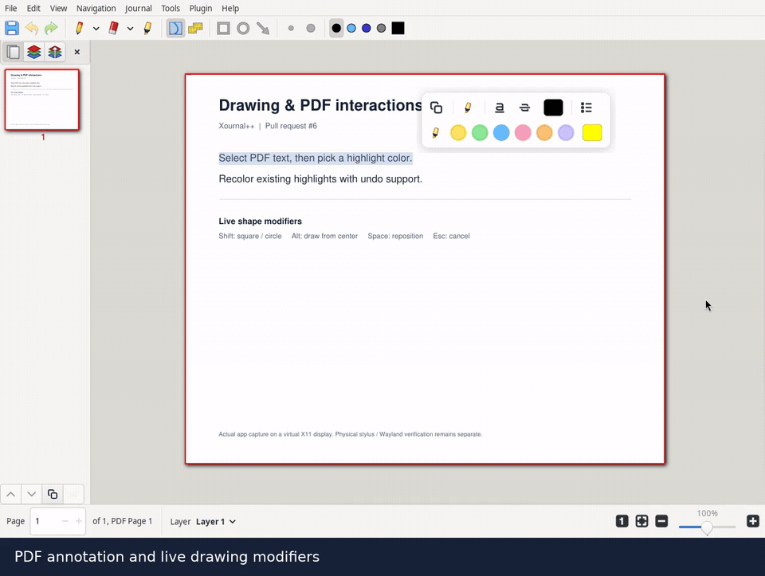
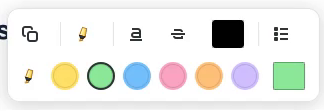
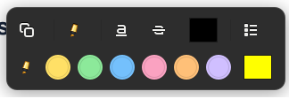
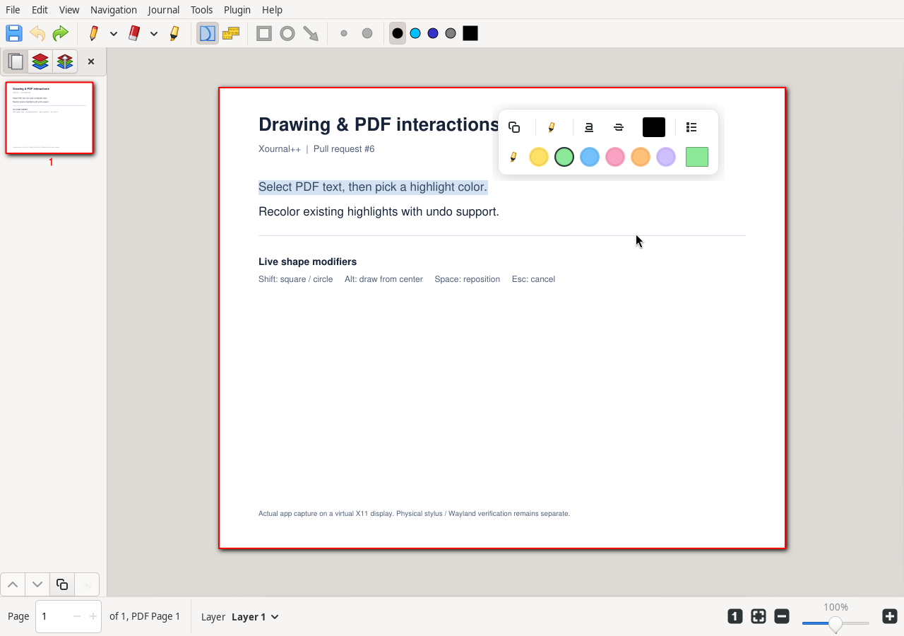
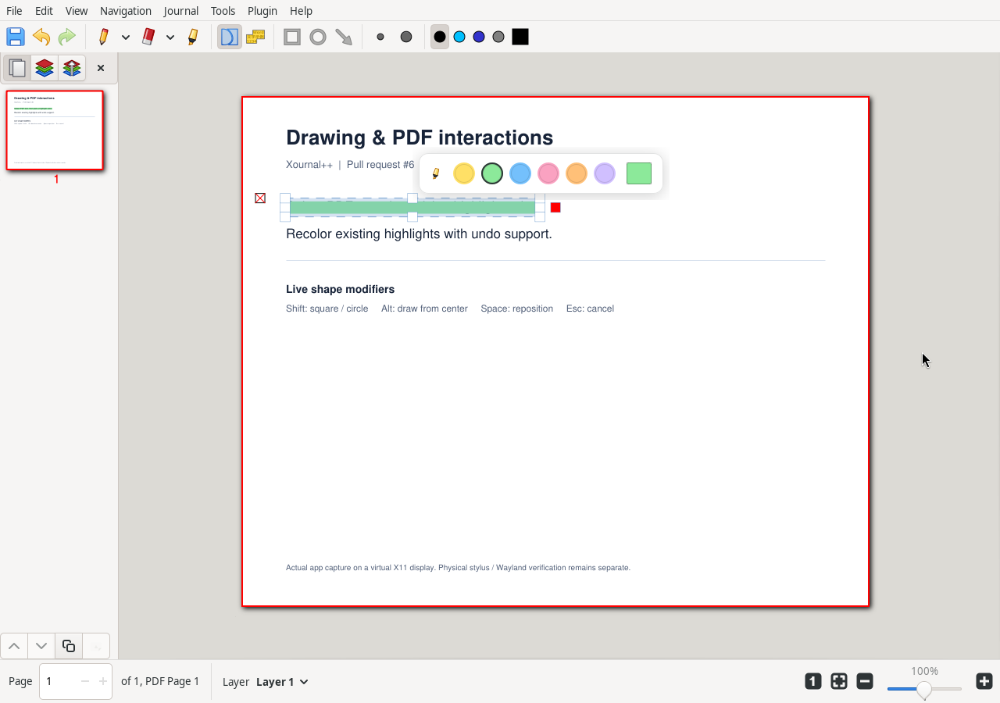
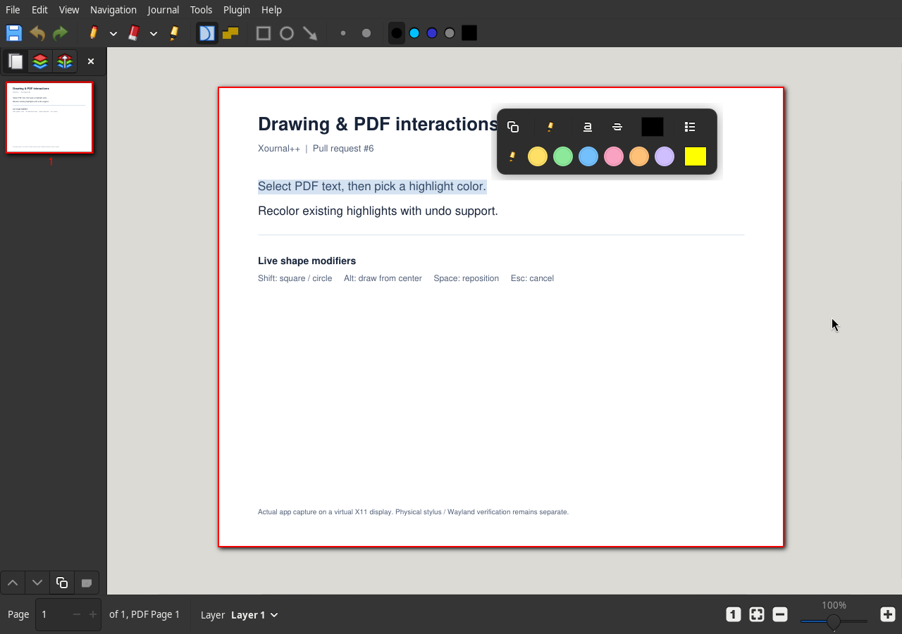
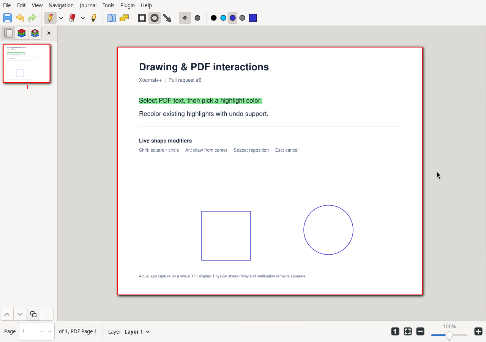
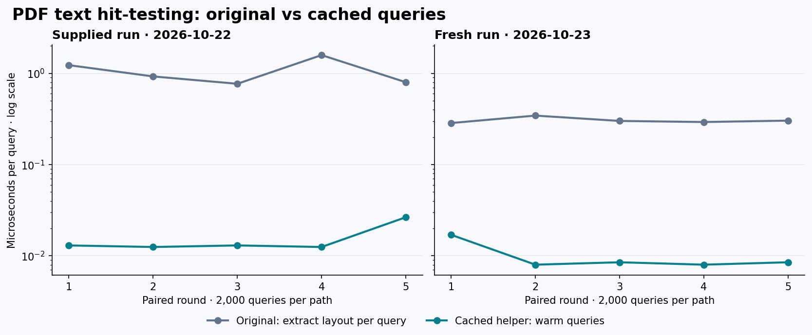

# Drawing and PDF interaction demo

Review media for [pull request #6](https://github.com/Okumans/xournalpp/pull/6).

## Demo

[Watch or download the MP4](demo.mp4).

The recording shows the actual application built from this PR on a virtual X11 display. Mouse and keyboard input are automated. The floating annotation toolbar is icon-only, with tooltips and accessible names. The main toolbar is customized to keep Smart Select, PDF text selection, Rectangle, and Ellipse visible.

## Screenshots

| Light theme | Dark theme |
| --- | --- |
|  |  |

### PDF text selection and contextual colors

### Highlight recoloring

### Dark theme

### Highlights and constrained drawing

## Try it

Open [example.pdf](example.pdf) in the PR build.

1. Use Smart Select to drag across the first sentence. The floating toolbar exposes separate highlight and text-color swatches.
2. Click a preset highlight color to apply it immediately without leaving Smart Select. The last swatch opens the full color chooser. Select the highlight again for the compact recolor palette; changing its color supports undo.
3. Select Pen, then Rectangle (`Ctrl+2`). Start a drag and press/release Shift while holding the mouse button to see the constraint update live.
4. Hold Alt during a shape drag to construct from the center. Hold Space to move the shape; press Esc to cancel an unfinished shape.
5. Choose Ellipse (`Ctrl+3`) and hold Shift to draw a circle. Pen/Highlighter also support Shift-click connected segments.
6. Hold Space to pan temporarily; use `[` and `]` to adjust the active tool width.

## Benchmark and validation

See [the benchmark report](BENCHMARK.md) for all five rounds, cold-query timing, scope, and reproduction commands. The chart and report show the original supplied validation log alongside a fresh run on 2026-10-23; these numbers measure a small fixture, not overall app speed.

Original supplied reports:

- [152 unit tests, zero failures](validation/unit-results.xml)
- [23 GTK integration tests, zero failures](validation/gtk-results.xml)
- [Raw PDF hit-test benchmark](validation/pdf-hit-benchmark.log)

Physical stylus feel and native Wayland behavior still require verification on real hardware.

Fresh validation on 2026-10-23:

- [152 unit tests, zero failures](validation/unit-results-current.xml).
- [24 GTK cases, zero failures](validation/gtk-results-current.xml), including the new preset-highlight regression. Each case ran in a separate process and D-Bus session on a virtual X11 display. The combined run in this GLib 2.84 environment fails during repeated application registration, so it is not reported as a passing combined suite.
- [Fresh five-round benchmark](validation/pdf-hit-benchmark-current.log).
- Release application build, Glade XML parsing, clang-format 21.1.8, and `git diff --check` passed.

Capture build: GCC 14.2, GTK 3.24.49, Poppler 25.03.0, plugins enabled; optional audio, GtkSourceView, QPDF, and cpptrace disabled.
